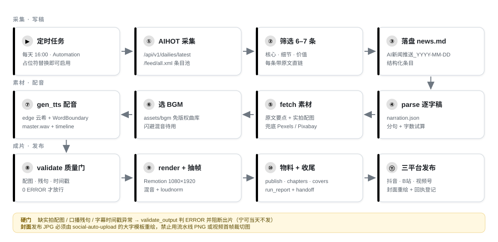
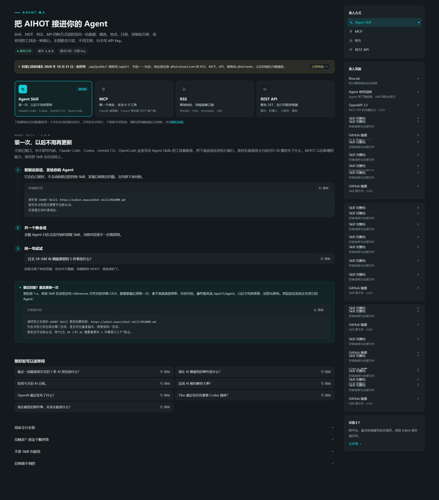

# todaynew · 每日 AI 头条短视频流水线

定时任务拉起 → 抓取今日 AI 要闻 → 写逐字稿 → 配音 / 逐字字幕 / 实拍配图 / 免版权 BGM → Remotion 渲染 9:16 成片 → `social-auto-upload` 三平台自动发布。整条链路**无人值守**，人工只在两处介入：写稿口径的可选微调，以及出片后的抽帧目检。

不接付费服务：TTS 默认免费 edge-tts，配图以原文实拍图为主、Pexels/Pixabay 兜底，新闻源用免费匿名的 AIHOT。

**快速跳转**：[全链路流程图](#全链路流程图) · [示例成片](#示例成片--2026-10-24) · [5 分钟跑通](#5-分钟跑通) · [定时任务](#无人值守定时任务) · [测试](#测试)

---

## 全链路流程图



三个不可让步的取舍：

| 取舍 | 原因 |
|---|---|
| 缺配图 = ERROR，**阻断出片** | 文字卡视频比当天不发更伤账号；宁可断，不降级 |
| 口播残句 = ERROR | "研究团队称……" 这类半句一旦播出无法修正 |
| 发布封面**必须重绘** | 显式传封面会短路自动重绘且无告警，三平台封面会全部出错 |

---

## 示例成片 · 2026-10-24

| 成片预览（8 段截取） | 发布封面 3:4 |
|---|---|
|  |  |

| 项目 | 实测值 |
|---|---|
| 成片 | 53.4s · 1080×1920 · 30fps · H.264 + AAC |
| 口播 | 356 字 / 7 条要闻，edge-tts 云希（语速 +30%） |
| 音频 | BGM 闪避混音，−15.5 LUFS / TP −0.8 dBTP / LRA 4.1 |
| 配图 | 7 张实拍照片（原文 1 / Pexels 6 / 缺失 0），md5 去重，无文字卡 |
| 字幕 | 逐字 KTV 高亮，分页不拆英文词与数字 |
| 物料 | `publish.md` + `chapters.json`（9 条）+ 3:4 / 4:3 / 16:9 封面 |
| 发布 | 抖音 ✅ · B 站 ✅ [BV1RpHP6bEvj](https://www.bilibili.com/video/BV1RpHP6bEvj) · 视频号 cookie 过期未发 |

---

## 5 分钟跑通

```bash
git clone <this-repo-url> todaynew && cd todaynew

cd remotion && npm install && cd ..          # Node 18+
pip install -r skills/todayaihot/requirements.txt
cp .env.example .env                          # 填 PEXELS_API_KEY 与 PIXABAY_API_KEY

cd skills/todayaihot
python scripts/run_all.py --smoke             # 冒烟：6 秒测试片，不需要任何 Key
```

冒烟产物在 `out/2026-09-06/`，验证「Python → ffmpeg → Remotion」链路通畅，可直接删除。随后跑真实内容：

```bash
python scripts/run_all.py "/绝对路径/AI新闻推送_2026-10-24.md" --backend edge --concurrency 1
```

### 环境要求

| 组件 | 版本 | 说明 |
|---|---|---|
| Python | 3.10+ | `requests` `beautifulsoup4` `lxml` `pillow` `numpy` `edge-tts` `websocket-client` |
| Node.js | 18+ | 仅渲染用；`render.py` 自动探测 node |
| ffmpeg | 需含 `asplit/aloop/sidechaincompress/amix/loudnorm` | **BGM 闪避混音必需**，Remotion 自带的精简构建不够用 |
| Chrome Headless Shell | 自动 | 首次渲染时 Remotion 自动下载 |

`check_deps.py` 会实测滤镜链并明确报告可用性。ffmpeg 两种处理：

```bash
set TODAYAIHOT_FFMPEG=D:/path/to/ffmpeg/bin/ffmpeg.exe   # 方式 A：指向完整构建（推荐）
python scripts/run_all.py "news.md" --no-bgm             # 方式 B：关 BGM，只做响度归一
```

### 配置密钥

`.env` 已在 `.gitignore` 中，永不入库。

| 变量 | 必需 | 说明 |
|---|---|---|
| `PEXELS_API_KEY` | ✅ | 实拍配图兜底 |
| `PIXABAY_API_KEY` | ✅ | 实拍配图兜底 + BGM 检索 |
| `VOLC_TTS_API_KEY` | ❌ | 火山 seed-tts-2.0，填了才能用 `--backend volc` |
| `TTS_EDGE_VOICE` | ❌ | 默认 `zh-CN-YunxiNeural`（云希） |
| `TODAYAIHOT_FFMPEG` / `TODAYAIHOT_BGM_DIR` | ❌ | 完整 ffmpeg 路径 / BGM 目录 |

> 两个图库 Key **必须都填**。只留一个源时，一旦原文抓图失败，配图兜底会静默失效、画面退化成文字卡——正是本项目要杜绝的情况。

### 新闻数据源（AIHOT）

免费匿名聚合站 [aihot.news](https://aihot.news)（监控 884 个信源，每日 08:00 出 AI 日报）。个人 / 公益 / 组织内部使用免费，商业用途需向 AIHOT 取得授权。旧域名 `aihot.virxact.com` 自 2026-10-31 起仅跳转。

| 端点 | 用途 |
|---|---|
| `/api/v1/dailies/latest` | 最新日报（精选 + 快讯） |
| `/api/v1/dailies?limit=7` | 日报索引 |
| `/feed/all.xml` | 全部动态 RSS（条目池） |
| `/items/{id}` | 条目详情页（AI 导读 + 原文链接） |

官方「把 AIHOT 接进你的 Agent」接入页（Skill / MCP / RSS / REST API 任选）：



新闻简报也可手写或来自其他来源——只要符合下面的格式，流水线不绑定任何新闻源账号体系。

### 简报格式（流水线硬依赖）

```markdown
# AI 新闻推送 · 2026-10-24

**1. 标题**
核心：一句话概括。
细节：关键更新点。
价值：对开发者/企业的影响。
原文：https://example.com/some-article
```

每条**必须**有原文直链（抓图靠它定位），三行要点写满，建议 6–7 条（对应 50–60 秒）。

---

## 无人值守定时任务

`skills/todayaihot/references/automation-prompt.md` 是可直接投喂**任意 agent** 的定时任务提示词：路径全部用占位符，不需要改代码。

对 agent 说一句即可：

> 读取 `<PROJECT_ROOT>/skills/todayaihot/references/automation-prompt.md`，替换占位符后创建每天 16:00 的定时任务。

WorkBuddy 中等价于 `automation_update(mode="create", rrule="FREQ=DAILY;BYHOUR=16;BYMINUTE=0", prompt=...)`；其他 agent 用各自的 cron / schedule 能力即可。任务每天串起：AIHOT 采集 → 写 `news.md` → `run_all.py` 出片 → 抽帧目检 → 三平台发布 → 回写 `handoff.md`。

不想自动发布就删掉提示词里的「第六步」（发布依赖外部 `social-auto-upload` 与三平台 cookie）。

---

## 命令与参数

```bash
python scripts/run_all.py "news.md" [参数]
```

| 参数 | 说明 |
|---|---|
| `--preview` | 只解析并打印口播字数，**零副作用**（不写 `seen_titles.json`、不覆盖 `narration.json`）。改稿前先跑它 |
| `--only parse\|fetch\|tts\|render` | 单环节执行（`--only render` 会顺带补 gen_publish + finalize） |
| `--backend edge\|volc\|auto\|gptsovits` | TTS 后端，默认 `edge` |
| `--force-tts` | 强制全量重合成。**正常重跑不需要**：缓存按「文本+后端+语速+音量」指纹复用 |
| `--concurrency 1` | 渲染并发，默认 1（并发 2 曾 OOM） |
| `--no-bgm` / `--skip-render` / `--check-links` / `--smoke` | 关 BGM / 只到时间轴 / 校验链接 / 冒烟 |

六环节产物：

| # | 环节 | 脚本 | 产物 |
|---|---|---|---|
| 1 | 解析 | `parse_news.py` | `work/narration.json` |
| 2 | 抓取富化 | `fetch_news.py` | 补全要点 + `remotion/public/images/` |
| 3 | 配音 | `gen_tts.py` | `work/audio/master.wav` + `work/timeline.json` |
| 4 | 渲染 | `render.py` | `out/<date>/*.mp4` + `covers/` + `chapters.json` |
| 5 | 发布物料 | `gen_publish.py` | `out/<date>/publish.md` |
| 6 | 收尾 | `finalize.py` | `run_report.json` + `handoff.md` 登记 |

**改稿姿势**：改 md → `--preview` 确认 325–385 字 → `--skip-render` 验配音字幕 → 满意后跑完整流水线。

**换配图**：改 `work/narration.json` 的 `visual.images`（**复数数组**）后重跑 `gen_tts.py` 再 `render.py`——render 读的是 `timeline.json` 内嵌快照，只改 narration 再 `--only render` 不会生效。

---

## 目录结构

```
todaynew/
├── skills/todayaihot/          # 流水线源码
│   ├── scripts/                # run_all / parse / fetch / gen_tts / render / gen_publish / finalize / validate_output / common
│   ├── references/             # 契约、规范、踩坑记录、定时任务提示词
│   ├── tests/                  # pytest 回归测试
│   └── USAGE.md
├── remotion/                   # 渲染工程（src/scenes 场景、src/components 字幕与主题）
├── assets/bgm/                 # 20 首免版权 BGM（随仓库入库）
├── docs/                       # 优化方案、审阅证据、示例图；docs/diagrams 为流程图源脚本
├── out/<date>/                 # 成片与发布物料（不入库）
├── work/                       # 中间产物（不入库）
└── handoff.md                  # 每次成片登记，供发布环节读取
```

---

## 关键机制

**字幕为什么对得上音**：`gen_tts.py` 用 edge-tts 的 WordBoundary 词边界直接产出逐字相对时间戳（`chars[].t` 相对句首）。基准是 `master.wav = [0.1s 静音][逐句 PCM]` 且 `clause.start = 0.1 + 游标`；视频中音频从**第 0 帧**起播，于是「wav 位置 == 视频时间」严格成立。**不要**给 `<Audio>` 再套延迟 `Sequence`，否则字幕整体偏移 0.1 秒（`test_timing_contract.py` 已锁定）。

**配图判定**：`looks_like_text_image()` 四判据（颜色唯一度 / 彩色度 / 主色占比 / 前 3 色集中度）。它是**高置信度过滤器而非完备判据**——厂商博客那种「浅色渐变底 + 居中大字」标题卡能全部通过，所以出片后必须抽帧目检。

**版式安全区**：正文区止于 `CONTENT_BOTTOM_LIMIT`（`videoConfig.ts`），字幕贴底 `SUBTITLE_BOTTOM`，两者由同一组常量推导，避免正文被字幕压住。

**质量门**：`validate_output.py` 在渲染前自动运行，0 ERROR 才放行——缺配图 / 配图损坏 / 口播残句 / 时间戳为负或逆序 / clause 时间轴不连续。`finalize.py` 给出 `READY`（可发布）/ `GENERATED`（物料不全）/ `BLOCKED`（不得发布）。

**出片后抽帧（必做）**：

```bash
ffmpeg -i out/<date>/每日ai热门新闻-<date>.mp4 -vf "select='eq(n\,90)+eq(n\,240)+eq(n\,390)'" -vsync vfr frames_%02d.jpg
```

确认：配图是真实照片、各条配图不重复、KTV 字幕有黄白高亮、要点未被字幕遮挡。

**封面分工**：流水线用 Remotion still 产出 3:4 / 4:3 / 16:9 PNG（预览与备用）；**发布用 JPG 必须由 `social-auto-upload` 的 codebase-style 大字模板重绘**，不得把 PNG 或首帧裁切图当发布封面。

---

## 测试

```bash
cd skills/todayaihot
python -m pytest tests/ -q          # 80 passed
```

覆盖时间基准契约、口播残句三层防线、质量门判定、配音缓存指纹、跨天去重、run_report 状态机、混音链路预检、标点归一化、环节编排。需要完整 ffmpeg 的用例在缺失时 **skip** 而非失败。

---

## 常见问题

| 现象 | 处理 |
|---|---|
| `Cannot find module '../../work/timeline.json'` | `work/` 不入库。只跑 typecheck 有 `.d.ts` 兜底；要渲染先跑 parse + tts（或 `--smoke`） |
| 混音链路预检未通过 | ffmpeg 缺滤镜链，设 `TODAYAIHOT_FFMPEG` 或 `--no-bgm` |
| `No available ports found` | 3000–3100 被 Windows 排除端口段占用；`render.py` 会自动改探 4000–4100 / 18000–18050，仍失败则关掉占用端口的代理或安全软件 |
| 画面全是文字卡 | `.env` 两个图库 Key 没配或失效 |
| KTV 字幕全程不变黄 | `chars[].t` 不是相对句首，检查 `align_whisper.py` |
| 配音是女声 | 用了非 edge 后端；指定 `--backend edge` |
| 成片明显偏短 | 条目被解析少了，用 `--preview` 看字数与条数 |
| edge-tts 429 | 微软侧瞬时风控，`gen_tts.py` 内置 4 次重试，通常自愈 |
| 渲染 OOM | `--concurrency 1`，不要调大 |

---

## 二次开发

- **配置唯一来源**：`scripts/common.py`（`PROJECT_ROOT` / `BGM_DIR` / `WIDTH·HEIGHT·FPS` / `CONCURRENCY`）。
- **新增场景**：`remotion/src/scenes/` 加组件 → `NewsVideo.tsx` 的 `SceneRouter` 加 case → `parse_news.py` 产出对应 `visual.type`。
- **新增 TTS 后端**：在 `scripts/tts_backend.py` 实现 `synth()`，返回 `(wav 路径, 词边界列表)`。
- **改流程图**：编辑 `docs/diagrams/generate_pipeline_flow.py` 后重跑它，会重新生成 `docs/images/pipeline-flow.svg`（4 列 × 3 排回行布局，避免竖向过长）。

## 安全与隐私

`.env` 永不提交（仓库内只有无真值的 `.env.example`）；密钥只从环境变量读取，代码无明文默认值；`work/`、`out/`、`remotion/public/audio|images/`、音视频文件均已忽略；日志与交接文件不写密钥值。若 fork 后误提交了 Key，请立刻到平台吊销——Git 历史无法靠删文件抹除。

## 许可证

代码与文档采用 **MIT**，见 [LICENSE](LICENSE)。BGM 原始授权、新闻内容版权与署名说明见 [NOTICE.md](NOTICE.md)。
